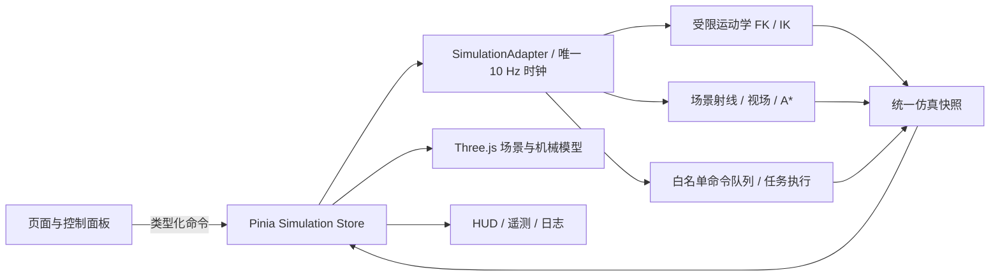

# NEXT ROBOTICS 架构说明

## 单一数据流

页面只发送命令和读取状态，不生成独立运动、感知或随机参数。`SimulationAdapter` 同时推进两机状态、指令和任务，形成完整快照。Store 以约 2 Hz 记录最近一分钟、每机最多 120 条遥测。机器人的世界位移和局部机身姿态分开存储；能源按统一配置积分。暂停与急停在适配器控制边界处理。

## 模块职责

| 位置 | 职责 |
| --- | --- |
| `src/views/`、`src/components/` | 路由、输入、状态反馈、场景挂载与 HUD |
| `src/stores/simulation.ts` | 命令入口、快照订阅、有限历史、设备选择、画质请求与本地声音 |
| `src/stores/lab.ts` | 唯一结构展示状态：拆解进度、选择、可见性与显示模式 |
| `src/services/SimulationAdapter.ts` | 单一时钟、控制权切换、两机运动、任务与快照发布 |
| `src/services/AIProvider.ts` | 本地解析与安全代理协议；外部结果重新验证 |
| `src/simulation/` | 受限关节、FK/IK、几何感知、导航、任务、白名单与遥测派生 |
| `src/three/RobotModel.ts`、`RobotParts.ts` | 原创机械模型、具名部件、真实父子关节、部件内同材质几何合并 |
| `src/three/createScene.ts` | 单一场景循环、相机、拾取、画质自适应、初始化/运行失败与统一释放 |
| `src/three/RobotLab.ts` | 在原模型上叠加拆解、透明、高亮、骨骼、关节轴与聚焦边界 |
| `src/three/EnvironmentModel.ts`、`PerceptionScene.ts`、`MissionScene.ts` | 共用尺寸的环境实体与统一快照可视化 |
| `src/config/`、`src/types/` | 机型、关节、传感器、场景、任务与命令类型 |

## 渲染和画质

机器人模型消费已确认姿态，渲染插值保留足端接触约束。静态 Mesh 固定局部矩阵，部件和关节 Group 继续更新；同材质几何只在同一部件内合并，不跨越拾取、隐藏或拆解边界。地台刻度采用一个 InstancedMesh。

用户画质保存在 Store，实际渲染档位仅由所属场景持有。HIGH/MEDIUM/LOW 控制像素比与阴影；连续三个约一秒窗口低于 45 FPS 时降低一档。不会自动升档，避免反复抖动。设置中的“应用画质”以修订号发出重新采样请求，可以直接重试当前档位；场景标签显示实际降级结果。点云密度继续使用感知设置中的独立控制，不因渲染降级改变模拟识别结果。

页面隐藏时停止场景 rAF，仿真适配器也停止推进；恢复时重置帧时间并仅启动一个场景循环。已经隐藏的机器人保持原有不更新语义。场景不持有另一套任务或机器人状态。

## 生命周期与失败恢复

- 路由卸载、手动重载和初始化失败共用幂等 `dispose`：取消 rAF、注销 ResizeObserver/事件、停止相机补间、释放 controls、几何、材质、实例缓冲、阴影、环境和 WebGL 上下文。
- 实验室恢复原材质后释放变体与辅助对象；感知/任务删除对应 DOM 标注和连接线。场景所有者释放仍在场景树中的 GPU 资源。
- 渲染错误或 WebGL 丢失中断循环并显示重新加载入口；可见性变化不能重启已失败循环。重载沿用 Store 快照，连续点击不会创建重复场景。
- ECharts 只随组件挂载存在，卸载释放实例和观察器。Store 卸载停止适配器与音频上下文。声音默认关闭，仅为已接受的用户操作产生本地短音。
- 模型、环境与图表随工程提供，无运行时外部资源下载。AI Key 只保存在会话内存；真实 AI 需要安全服务代理。

## 真实性边界

这是原创概念机械模型的运动学与几何感知 **SIMULATION**。不提供刚体动力学、真实硬件控制、SLAM 或视觉模型推理。负载、能源、稳定度和硬件读数是统一演示估算；浏览器 FPS 与渲染资源数量是实测。原地动作练习、AI 动作演示和任务中心对象操作使用同一动作入口，业务控制权与完成条件不同。
